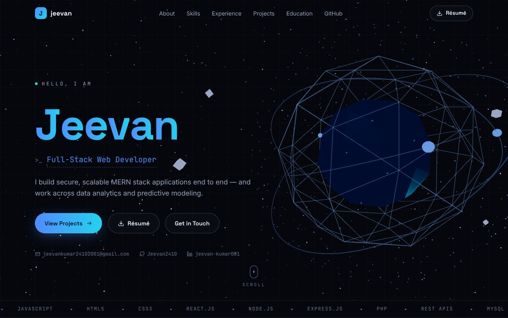
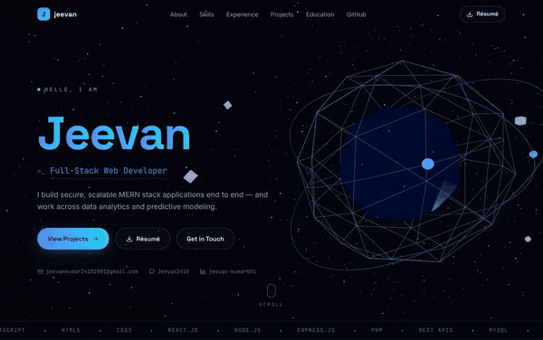

# DigitalCV — Jeevan's Interactive 3D Portfolio

Personal portfolio/resume website for **Jeevan** — Full-Stack Web Developer & MCA graduate.
Every fact on this site comes from `JEEVAN.pdf` / `JEEVAN_resume.docx` or the public
GitHub profile [github.com/Jeevan2410](https://github.com/Jeevan2410). Nothing is invented.





## Stack

- **Vite 7 + React 19** — fast builds, manual chunk splitting
- **Three.js + @react-three/fiber** — procedural 3D (identity core, starfield, skills constellation); zero 3D asset downloads
- **Framer Motion** — scroll reveals, hero choreography, modals
- **Hand-written CSS** design system (no UI framework)
- **GitHub REST API** (unauthenticated, client-side) with a verified static fallback — no keys, no secrets

## Run

```bash
npm install
npm run dev       # dev server
npm run build     # production build → dist/
npm run preview   # serve the production build locally
```

## Structure

```
src/
  data/            # single source of truth — all resume facts (profile.js, projects.js)
  state/           # app context (accent, toasts, terminal, dev mode, active section)
  hooks/           # reduced motion, mobile, WebGL detect, Konami, GitHub repos
  three/           # SceneCanvas (fixed bg), SkillsConstellation
  components/      # Preloader, Nav, Hero, About, Skills, Experience, Projects,
                   # Education, GitHubSection, Contact, Footer, Terminal, DevMode,
                   # ConnectFour, MatrixRain, CustomCursor, ToastStack
public/
  resume.pdf       # the source resume
  favicon.svg|png, og-image.png
scripts/
  gen-assets.ps1   # regenerates og-image.png / favicon.png (PowerShell + GDI+)
```

## Features

- Interactive 3D hero (identity core with orbit rings + shards, starfield, mouse parallax,
  scroll choreography, click impulse). Hovering a project **re-lights the whole scene**.
- Skills constellation on desktop; static category cards on mobile/reduced-motion.
- Project detail modals with keyboard focus trap; featured projects sourced strictly
  from the resume (no repo links fabricated).
- Live GitHub section (public API, falls back to a verified snapshot).
- Easter eggs: Konami code → Matrix rain · `~` or footer `>_` → developer terminal
  (`help`, `whoami`, `skills`, `projects`, `goto <section>`, `dev`, `play`…) ·
  developer-mode HUD (FPS, section, viewport) · hidden playable Connect 4 (a real repo) ·
  custom cursor with click bursts and hold-to-reveal facts.
- Accessibility: semantic landmarks, skip link, focus-visible, aria labels, modals trap
  focus, full `prefers-reduced-motion` support, 3D is purely decorative.
- SEO: title/meta/OG/Twitter tags, JSON-LD Person schema, sitemap-free single page.

## Deploy

Any static host. For Vercel: import the repo, framework preset **Vite**, build
`npm run build`, output `dist/`.
